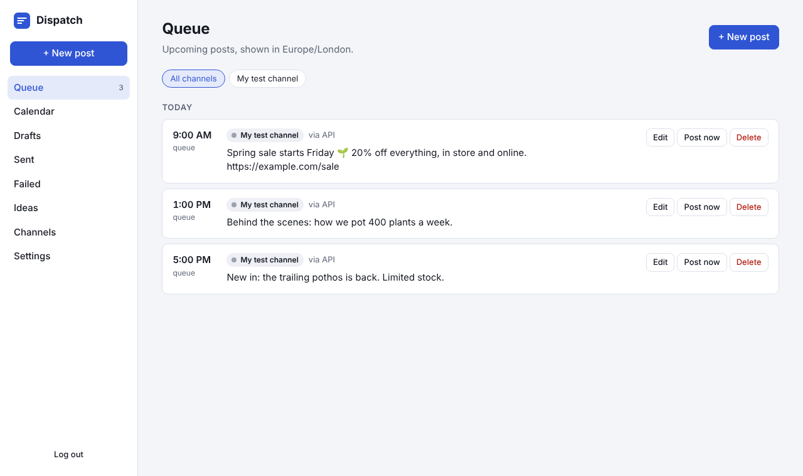

# Dispatch

Your own social media scheduler, in the spirit of Buffer. Write a post once, pick your channels, and Dispatch publishes it at the next free slot in each channel's queue. AI agents can use it too, through a built-in MCP server and REST API.



- **Queue and calendar.** Set posting times per channel. "Add to queue" takes the next free slot; you can also pick an exact time, post now, or save a draft.
- **Real posting** to Facebook Pages, Instagram (photos and Reels), Bluesky, Mastodon, Threads, LinkedIn and X.
- **Photos and videos.** Upload them in the editor, or paste a link. Videos go to Facebook, Instagram Reels, Threads and Mastodon.
- **Everything else** (TikTok, Pinterest, YouTube) through a webhook to Make, Zapier or n8n, or as a phone reminder so you post it by hand.
- **AI drafting** with Claude: draft a post from a sentence, or rewrite one to fit a network.
- **Built for agents.** Claude Code, Claude Desktop, Cursor or n8n can list channels, draft, schedule and publish posts.
- **Yours.** One small Node app with a SQLite file. No accounts, no tracking. Channel passwords and tokens are encrypted on disk.

---

## Quick start

You need **Node.js 22.13 or newer** ([download](https://nodejs.org)), or Docker.

### With Node

```bash
cd dispatch
npm install
npm start
```

Open **http://localhost:8080**, set a password, and you're in.

### With Docker

```bash
cd dispatch
cp .env.example .env      # optional: add your settings
docker compose up -d
```

Your data is kept in `./data`.

### Try it without connecting anything

In **Channels → Add channel**, choose **Test channel (no posting)**. Posts sent to it are logged in the server window instead of published, so you can try the queue, calendar and agent tools safely.

---

## Connecting channels

Open **Channels → Add channel**, pick the network and paste the details below. Dispatch checks them before saving.

| Network | What you need | Time |
|---|---|---|
| **Facebook Page** | Your Page ID and a Page access token from your own Meta developer app. Step by step: [Connecting a Facebook Page](#connecting-a-facebook-page). | 10 min |
| **Instagram** | A Professional (Business or Creator) account linked to a Facebook Page, plus that Page's ID and token. Step by step: [Connecting Instagram](#connecting-instagram). | 5 min after Facebook |
| **Bluesky** | Your handle and an **app password** (Bluesky → Settings → Privacy and security → App passwords). | 1 min |
| **Mastodon** | Your instance (e.g. `mastodon.social`) and an access token: Preferences → Development → New application, tick `write:statuses` and `write:media`, save, then copy "Your access token". | 2 min |
| **Threads** | A long-lived user access token from a [Meta developer app](https://developers.facebook.com/docs/threads/get-started) with `threads_basic` and `threads_content_publish`. Tokens last 60 days. | 15 min |
| **LinkedIn** | An access token from a [LinkedIn developer app](https://www.linkedin.com/developers/apps) with the "Share on LinkedIn" and "Sign In with LinkedIn using OpenID Connect" products (scopes `openid profile w_member_social`). Tokens last 60 days. For a company page, add its `urn:li:organization:…` (needs `w_organization_social`). | 15 min |
| **X (Twitter)** | From [developer.x.com](https://developer.x.com): the API key and secret, plus an access token and secret generated **after** setting the app to Read and Write. Posting through the API may need a paid X API plan. | 10 min |
| **Webhook** | A webhook URL from Make, Zapier, n8n or your own server. Dispatch POSTs `{ text, image_url, channel, scheduled_at }` at posting time. Use this to reach TikTok, Pinterest or YouTube through an automation tool that already has access. | 5 min |
| **Phone reminder** | Install the [ntfy](https://ntfy.sh) app and subscribe to a hard-to-guess topic. At posting time you get the text (and image) on your phone and post it by hand. | 2 min |

Each new channel gets a default schedule of weekdays at 9:00, 13:00 and 17:00. Change it on the channel card.

### Photos and videos

In the editor, click **Upload file**, or paste a public link to an image or video. Accepted types are JPEG, PNG, GIF, WebP, MP4 and MOV, up to 1 GB (change it with `MAX_UPLOAD_MB`).

| Network | Photos | Videos | Works while Dispatch runs only on your computer? |
|---|---|---|---|
| Facebook Page | ✅ | ✅ | ✅ Dispatch sends the file directly |
| Instagram | ✅ JPEG only | ✅ as Reels | Reels ✅. Photos ❌ need a public address |
| Threads | ✅ | ✅ | ❌ needs a public address |
| Mastodon | ✅ | ✅ (most servers allow about 40–100 MB) | ✅ |
| Bluesky | ✅ up to 1 MB | ❌ posts the text only | ✅ |
| X, LinkedIn | ❌ posts the text only | ❌ posts the text only | n/a |

**Why some networks need a public address:** Instagram photos and Threads don't accept files. They download the media from a link, so that link must be reachable from the internet. Run Dispatch on a server with a domain (see [Running it on a server](#running-it-on-a-server)) and set `PUBLIC_URL`. Until then, paste a link to media hosted elsewhere, such as a direct link from a Cloudflare R2 or S3 bucket.

When one post goes to several networks and one of them can't take the media, that network gets the text only. The editor warns you before you schedule.

Uploaded files are served at `/media/<random name>` so the networks can fetch them. The names are random and can't be guessed. Files that no post uses are deleted after 7 days.

### Connecting a Facebook Page

You post through your own Meta developer app. Because you are the app's admin and the Page's admin, you don't need Meta's app review.

1. **Create the app.** Go to [developers.facebook.com/apps](https://developers.facebook.com/apps), click **Create app**, and choose the use case **Manage everything on your Page**. Give it any name.
2. **Get a user token.** Open **Tools → [Graph API Explorer](https://developers.facebook.com/tools/explorer/)**. Pick your app under *Meta App*, choose **User Token**, and add the permissions `pages_show_list`, `pages_read_engagement` and `pages_manage_posts`. Click **Generate Access Token**, log in, and tick the Page you want to post to.
3. **Make it long-lived.** Click the **ⓘ** next to the token, then **Open in Access Token Tool**, then **Extend Access Token** at the bottom. Copy the new token. It lasts 60 days.
4. **Get the Page token.** Back in the Graph API Explorer, paste the long-lived token into the *Access Token* box and run `GET me/accounts`. Find your Page in the result and copy its `id` (the **Page ID**) and its `access_token` (the **Page access token**). A Page token made from a long-lived user token doesn't expire.
5. **Add it to Dispatch.** Go to **Channels → Add channel → Facebook Page**, paste both values, and click **Connect**.
6. **Make the app Live.** In the app dashboard, switch **App Mode** from Development to **Live**. Meta asks for a privacy policy URL and a category first. While the app is in Development mode, posts it publishes may be visible only to you.

If posting later fails with an "Invalid OAuth access token" error, you changed your Facebook password or removed the app's access: repeat steps 2 to 5.

### Connecting Instagram

Instagram uses the same Meta app and Page token as Facebook.

1. **Use a Professional account linked to your Page.** In the Instagram app: **Settings → Account type and tools → Switch to professional account** (Business or Creator). Then link it to your Facebook Page: Instagram **Settings → Accounts Center**, or Meta Business Suite → **Settings → Instagram accounts**.
2. **Add the Instagram permissions to your app.** In your app dashboard, add the use case for Instagram (**Manage messaging & content on Instagram**, the version *with Facebook Login*). If you skip this, the permissions in the next step won't be listed.
3. **Generate the token again** in the [Graph API Explorer](https://developers.facebook.com/tools/explorer/), as in the Facebook steps 2 to 4, but this time add `instagram_basic` and `instagram_content_publish` as well. When asked, tick both your Page and your Instagram account.
4. **Add it to Dispatch.** Go to **Channels → Add channel → Instagram** and paste the same **Page ID** and the new **Page access token**. Dispatch finds the linked Instagram account by itself and shows its @username. Paste the new token into your Facebook channel too (remove it and add it again).

**What Instagram allows:**
- Every post needs media. Paste a **JPEG** image URL, or an **MP4/MOV** link to post a **Reel**. PNG and text-only posts are rejected by Instagram.
- Captions can be up to 2,200 characters, with at most 30 hashtags.
- The media URL must be publicly reachable, because Instagram downloads it at posting time.
- Instagram allows up to 100 posts per account per day through the API.
- Carousels and Stories aren't supported in this version.

---

## AI drafting

Add your Anthropic API key to `.env` and restart:

```
ANTHROPIC_API_KEY=sk-ant-...
```

The editor gets **Draft with AI** and **Rewrite** buttons, and agents get an `ai_draft_post` tool. Drafts are fitted to the character limit of the first selected channel. The default model is `claude-opus-5-5`; change it with `ANTHROPIC_MODEL`. Dispatch never publishes AI text on its own: you, or your agent, still choose when to schedule it.

---

## Using Dispatch with AI agents

First create an API key in **Settings → API keys**. The key is shown once.

### Claude Code

```bash
claude mcp add --transport http dispatch http://localhost:8080/mcp \
  --header "Authorization: Bearer dsp_your_key"
```

Then ask things like *"Schedule a post about our Saturday market to Bluesky and Mastodon"* or *"What's in my queue this week?"*.

### Claude Desktop (and other apps that launch a local command)

Add to `claude_desktop_config.json`, with the real path to this folder:

```json
{
  "mcpServers": {
    "dispatch": {
      "command": "node",
      "args": ["/path/to/dispatch/bin/dispatch-mcp.js"],
      "env": {
        "DISPATCH_URL": "http://localhost:8080",
        "DISPATCH_API_KEY": "dsp_your_key"
      }
    }
  }
}
```

The bridge forwards to your running Dispatch, so keep `npm start` (or Docker) running.

### n8n, Cursor and anything else that speaks MCP over HTTP

Endpoint: `http://your-server:8080/mcp`, header `Authorization: Bearer dsp_your_key`.

### MCP tools

| Tool | What it does |
|---|---|
| `list_channels` | Connected accounts with ids, limits and schedules |
| `get_settings` | Time zone and whether AI drafting is on |
| `create_post` | Create posts for one or more channels: `queue`, `schedule` (with `scheduled_at`), `draft` or `now` |
| `list_posts` | Filter by status, channel and time range |
| `update_post` | Edit text or image, reschedule, move to the queue or back to drafts |
| `publish_post_now` | Publish an existing post immediately |
| `delete_post` | Delete a post |
| `set_posting_schedule` | Change a channel's queue days and times |
| `add_idea`, `list_ideas` | Save and read content ideas |
| `ai_draft_post` | Draft or rewrite text with Claude (only when an API key is set) |

### REST API

Every endpoint takes `Authorization: Bearer dsp_your_key`.

```bash
# List channels
curl -H "Authorization: Bearer $KEY" http://localhost:8080/api/channels

# Add a post to the queue of two channels
curl -X POST -H "Authorization: Bearer $KEY" -H "Content-Type: application/json" \
  -d '{"text":"Fresh bread at 7am tomorrow","channel_ids":["CHANNEL_ID_1","CHANNEL_ID_2"],"mode":"queue"}' \
  http://localhost:8080/api/posts
```

| Method and path | Purpose |
|---|---|
| `GET /api/channels` | List channels |
| `PATCH /api/channels/:id` | Change `name`, `schedule` (`{days:[1-7], times:["HH:MM"]}`) or `active` |
| `GET /api/posts?status=scheduled&channel_id=&from=&to=` | List posts |
| `POST /api/posts` | Create: `text`, `channel_ids`, `mode` (`queue` · `schedule` · `now` · `draft`), `scheduled_at`, `image_url` |
| `PATCH /api/posts/:id` | Edit: `text`, `image_url`, `scheduled_at`, `mode` |
| `POST /api/uploads` | Upload a file: send the raw bytes, with headers `X-Upload-Name: clip.mp4` and `Content-Type`. Returns `{ url }` to use as `image_url`. |
| `POST /api/posts/:id/publish` | Publish now |
| `DELETE /api/posts/:id` | Delete |
| `GET/POST /api/ideas`, `DELETE /api/ideas/:id` | Ideas |
| `POST /api/ai/draft`, `POST /api/ai/rewrite` | AI text (needs `ANTHROPIC_API_KEY`) |

---

## Running it on a server

Dispatch only posts while it's running, so for posts to go out while your laptop is closed, run it on an always-on machine: a small VPS, a home server or a Raspberry Pi.

1. Copy the folder to the server and run `docker compose up -d`.
2. Put it behind HTTPS. With [Caddy](https://caddyserver.com), a two-line `Caddyfile` does it:
   ```
   dispatch.example.com {
     reverse_proxy localhost:8080
   }
   ```
3. In `.env`, set `SECURE_COOKIES=true` and `PUBLIC_URL=https://dispatch.example.com`, then restart.

**Backups:** copy the `data` folder. It holds the database and `secret.key`. Without `secret.key`, saved channel credentials can't be decrypted, and you'd need to reconnect your channels.

---

## How publishing works

- Every 20 seconds Dispatch publishes posts whose time has come.
- If a network is down or rate-limits, it retries after 2, then 4 minutes. After 3 attempts the post moves to **Failed** with the error, and you can fix it and retry.
- Errors that retrying won't fix, such as an expired token or a post that's too long, fail straight away.
- If Dispatch is stopped mid-publish, that post is marked **Failed** rather than retried, so you never get a duplicate. Check the network and retry or delete it.
- Character limits are checked per network when you schedule, using each network's own rules: Bluesky counts graphemes, and Mastodon and X count links as 23 characters.

---

## Troubleshooting

| Problem | Fix |
|---|---|
| "Could not connect to Bluesky: …401" | Use an app password, not your main password, and your full handle (`name.bsky.social`). |
| LinkedIn or Threads posts start failing after about two months | Their tokens expire after 60 days. Get a new token, remove the channel and add it again. |
| Facebook says "(#200) … pages_manage_posts" | The token is missing a permission or is a user token. Use the Page `access_token` from `me/accounts`, not the token from step 2. |
| "This Facebook Page has no linked Instagram Professional account" | Switch the Instagram account to Professional and link it to the same Page (Instagram step 1), then generate the token again. |
| "… downloads media from a public URL, but this file is on a local address" | Instagram photos and Threads can't reach Dispatch on your computer. Run it on a server and set `PUBLIC_URL`, or paste a public media link. |
| Instagram says it "could not process the media" | Use a JPEG image (not PNG or WebP) or an MP4/MOV video, at a public URL. |
| X returns 403 when posting | The access token was generated before you set Read and Write. Regenerate it. |
| LinkedIn returns 426 or an error about the version | Set `LINKEDIN_VERSION` in `.env` to a recent month, e.g. `202609`, and restart. |
| Posts didn't go out overnight | Dispatch must be running at posting time. Run it on a server (see above). |
| Forgot the password | Stop Dispatch, run `sqlite3 data/dispatch.db "DELETE FROM settings WHERE key='password_hash'"`, start it again, and set a new one. Channels and posts are kept. |

---

## Development

```bash
npm run dev     # restart on file changes
npm test        # unit and API tests
```

The code is plain JavaScript with no build step:

- `src/server.js`: HTTP server and REST API
- `src/service.js`: posts, channels, queue logic
- `src/scheduler.js`: publishing loop
- `src/mcp.js`: MCP server
- `src/publishers/`: one file per network
- `public/`: the web app

To add a network, copy `src/publishers/mastodon.js`, change `fields`, `verify` and `publish`, and register it in `src/publishers/index.js`.
